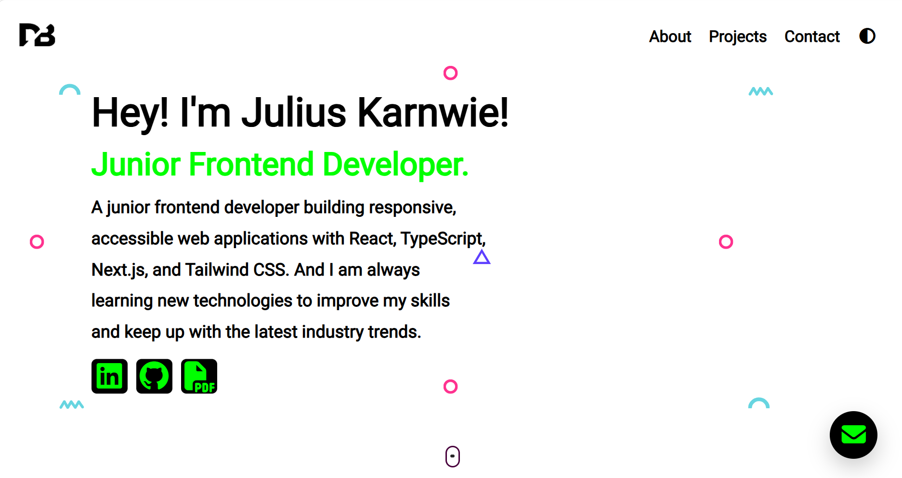

</> Markdown

## Portfolio Website Screenshot



## 🛠️ Tech Stack

* HTML5 — Website structure.
* CSS3 — Styling and responsive design.
* JavaScript (ES6+) — Interactive functionality.
* React — User interface development.

### 🚀 Key Features

*  📚 Diverse Project Showcase: Highlights projects built with various programming languages, frameworks, and modern front-end technologies to demonstrate technical versatility.
*  ⚡ Responsive & User-Friendly Design: Provides a clean, intuitive, and mobile-friendly interface for seamless browsing across desktops, tablets, and smartphones.
*  🎯 Skills & Career Readiness: Demonstrates practical coding experience, problem-solving abilities, and front-end development skills to showcase readiness for professional opportunities.

# Portfolio Website

🔗 **Live Demo:** [View Live Website](https://portfoliopebsitepurplegold.vercel.app/)

A responsive JavaScript portfolio that showcases my diverse skillsets and readiness to take on a new role.

## Portfolio Website Run Instructions

A personal portfolio website built with React, JavaScript, HTML5, and CSS3. The project showcases personal information, technical skills, projects, and professional resources.

## Table of Contents

* [Prerequisites](#prerequisites)
* [Project Structure](#project-structure)
* [Installation and Setup](#installation-and-setup)
* [Running the Project](#running-the-project)
* [Environment Variables](#environment-variables)
* [Building for Production](#building-for-production)
* [Troubleshooting](#troubleshooting)

## Prerequisites

Before installing and running the project, ensure the following tools are installed on your computer.

### 1. Node.js and npm

Node.js provides the JavaScript runtime, while npm manages project dependencies.

* Download Node.js from the [official Node.js website](https://nodejs.org/).
* Choose an appropriate LTS version.
* npm is included with the standard Node.js installation.

Verify your installation by running:

```bash
node -v
npm -v
```

Both commands should display version numbers.

### 2. Git

Git allows you to clone the repository and manage project versions.

Download Git from the [official Git website](https://git-scm.com/).

Verify the installation:

```bash
git --version
```

### 3. Code Editor

[Visual Studio Code](https://code.visualstudio.com/) is recommended for editing and managing the project files.

## Project Structure

The project contains the following files and directories:

```text
Portfolio-Website/
├── assets/
│   ├── blinker mockup.png
│   ├── chat.png
│   ├── chatgpt.png
│   ├── circle.svg
│   ├── copilot-color.png
│   ├── css.png
│   ├── David Bragg Resume.docx
│   ├── Eportfolio YT.png
│   ├── favicon.ico
│   ├── firebase.png
│   ├── Frontend Simplified.jpg
│   ├── Frontend Simplified.png
│   ├── github.png
│   ├── google mockup.png
│   ├── html.png
│   ├── icons8-tailwind-css.png
│   ├── imag 1.png
│   ├── imag 2.png
│   ├── imag 3.png
│   ├── imag 4.png
│   ├── imag 5.png
│   ├── imag 6.png
│   ├── imag 7.png
│   ├── js.png
│   ├── Julius Karnwie Resume.docx
│   ├── logo.svg
│   ├── nextjs-org-logo.png
│   ├── Node.js.png
│   ├── React JS.png
│   ├── semi circle.svg
│   ├── squiggly.svg
│   ├── triangle.svg
│   ├── typescript.png
│   ├── vercel-logo.png
│   └── Vite.js.png
├── index.html
├── index.js
├── README.md
└── style.css
```

**Key files and directories:**

* `assets/` — Contains images, SVG graphics, technology logos, mockups, and PDF résumé files.
* `index.html` — The HTML document that serves as the entry point for the website.
* `index.js` — The JavaScript entry point. Its exact role depends on how the application is configured.
* `style.css` — Contains the website's styling and layout rules.
* `README.md` — Documents the project and explains how to install and run it.

**Note:** The structure above reflects the files currently identified. If the application uses React, its source code and dependencies must also be present and correctly configured.

## Installation and Setup

### Step 1: Clone the Repository

If the project is hosted on GitHub, open a terminal and run:

```bash
git clone YOUR_REPOSITORY_URL
```

Replace `YOUR_REPOSITORY_URL` with the HTTPS or SSH URL of your repository.

Navigate into the cloned project directory:

```bash
cd YOUR_PROJECT_FOLDER
```

Replace `YOUR_PROJECT_FOLDER` with the actual directory name.

Alternatively, download the repository as a ZIP file from GitHub, extract it, and open the extracted folder in Visual Studio Code.

### Step 2: Open the Project in Visual Studio Code

From the project directory, run:

```bash
code .
```

If the `code` command is unavailable, open Visual Studio Code manually and select **File → Open Folder**.

Choose the root directory containing the project files.

### Step 3: Check the Project Configuration

Before installing dependencies, check whether the project contains a `package.json` file.

Run:

```bash
npm pkg get scripts
```

If this command reports an error because `package.json` does not exist, inspect the project files and determine whether the React project configuration is missing.

You can also run:

```bash
dir
```

On Windows, this lists the files and folders in the current directory.

On macOS or Linux, use:

```bash
ls -la
```

A configured React project typically contains:

* `package.json` — Defines dependencies and available npm scripts.
* A lockfile, such as `package-lock.json` — Records dependency versions.
* React source files.
* A configured build tool, such as Vite.

**Important:** Do not run `npm install` expecting it to reconstruct an entire missing React application. First verify that the required project files are present.

### Step 4: Install Dependencies

If `package.json` already exists, install the project's dependencies.

For a project with `package-lock.json`, run:

```bash
npm ci
```

This installs the dependency versions recorded in the lockfile.

If the project has `package.json` but no `package-lock.json`, run:

```bash
npm install
```

Wait until the installation finishes.

If neither file exists, the project configuration must be established before these commands can install the intended React application dependencies.

## Running the Project

The appropriate startup command depends on the project's configuration.

### Development Mode: Vite

If the project uses Vite and its `package.json` defines a `dev` script, run:

```bash
npm run dev
```

Vite will display a local development URL in the terminal, typically:

```text
http://localhost:5173/
```

Open the displayed URL in your browser.

Keep the terminal running while developing. Changes to supported source files will generally appear automatically through hot module replacement.

### Development Mode: Other React Setups

If the project uses Create React App and its `package.json` defines a `start` script, run:

```bash
npm start
```

The development server typically opens at:

```text
http://localhost:3000/
```

Use the command appropriate to the scripts defined in `package.json`. Do not assume that every React project uses Vite or Create React App.

### Static HTML Preview

If the repository contains only plain HTML, CSS, and JavaScript files, it may be possible to preview the site without installing React dependencies.

Open `index.html` using a local development server, such as the Live Server extension in Visual Studio Code.

However, a static preview is not a substitute for running a configured React application. If `index.html` loads React modules or other files that require a build tool, the appropriate development server must be used.

## Environment Variables

The project structure provided does not establish whether environment variables are required.

If the application does not use external APIs, authentication services, or other configurable services, you may not need a `.env` file.

If environment variables are required, create a file named `.env` in the project root.

For a Vite-based application, an example is:

```env
VITE_API_BASE_URL=https://api.example.com
```

Access the variable in JavaScript using:

```javascript
const apiBaseUrl = import.meta.env.VITE_API_BASE_URL;
```

Replace the example URL with the actual API endpoint used by the application.

For a Create React App project, public environment variables use the `REACT_APP_` prefix instead:

```env
REACT_APP_API_BASE_URL=https://api.example.com
```

Access the variable using:

```javascript
const apiBaseUrl = process.env.REACT_APP_API_BASE_URL;
```

**Security guidelines:**

* Never commit passwords, private API keys, access tokens, or other secrets to GitHub.
* Variables prefixed with `VITE_` or `REACT_APP_` are exposed to client-side code and must not contain secrets.
* Add `.env` to `.gitignore` when it contains local configuration or sensitive values.
* If environment variables change, restart the development server when necessary.

If the application does not require environment variables, skip this section during setup.

## Building for Production

A production build generates optimized files suitable for deployment.

### Vite

If the project defines the standard Vite build script, run:

```bash
npm run build
```

The optimized application is typically generated in the `dist/` directory.

To preview the production build locally, run:

```bash
npm run preview
```

Vite will display a local URL in the terminal. Open that URL to test the production build.

The preview server is intended for local verification, not as a production hosting service.

### Create React App

If the project uses Create React App and defines the standard build script, run:

```bash
npm run build
```

The optimized production files are typically generated in the `build/` directory.

Use a suitable static hosting provider or web server to deploy the resulting files.

### Deployment

The production build can be deployed to a compatible static hosting platform, such as Vercel or Netlify, depending on the project's configuration.

Before deployment, verify that:

* All images and other assets load correctly.
* Navigation links work.
* Résumé download links point to the correct files.
* The layout works on mobile and desktop screens.
* There are no unexpected errors in the browser console.
* The hosting configuration supports client-side routing if the application uses it.

## Troubleshooting

### 1. `npm` Is Not Recognized

**Possible cause:** Node.js is not installed correctly, or its installation directory is not included in your system's PATH.

**Solution:**

1. Install or reinstall Node.js using the official installer.
2. Close and reopen your terminal.
3. Run:

   ```bash
   node -v
   npm -v
   ```

### 2. `ENOENT: no such file or directory, open 'package.json'`

**Possible cause:** The terminal is in the wrong directory, or the project configuration is missing.

**Solution:**

1. Navigate to the project's root directory.
2. Confirm that `package.json` exists.
3. If it is missing, locate the correct project folder or restore the required project configuration before installing dependencies.

### 3. `Missing script: "dev"`

**Possible cause:** The project does not define a `dev` script.

**Solution:**

Inspect the available scripts:

```bash
npm run
```

Run the appropriate command listed in the output. For example, a project configured with a `start` script may use:

```bash
npm start
```

Do not add a Vite command unless Vite is installed and configured for the project.

### 4. Module Not Found

**Possible cause:** A dependency is missing, or an import points to a file that does not exist at the specified path.

**Solution:**

* Confirm that the imported file exists.
* Check the relative import path.
* Verify capitalization and spelling.
* Confirm that required dependencies are listed in `package.json`.
* Install dependencies if the project configuration is complete.

For example, an incorrect image import may prevent the application from compiling.

### 5. Images Are Not Displaying

**Possible cause:** An incorrect asset path, an unsupported URL, or a filename mismatch.

**Solution:**

* Verify that the image exists in the `assets/` directory.
* Check the path used in the HTML or JavaScript.
* Preserve filename capitalization and spaces where applicable.
* For Vite, assets in the `public/` directory can be referenced by their public URL paths. Assets imported from the source code can instead be processed by the build tool.
* Check the browser's developer console and Network panel for failed requests.

### 6. Port Already in Use

**Possible cause:** Another application is using the port required by the development server.

**Solution:**

* Stop the other server if it is no longer needed.
* If using Vite, allow it to select another available port when prompted.
* Alternatively, configure a different port in the project's development server settings.

### 7. Changes Are Not Appearing

**Possible cause:** The development server has not refreshed, the wrong project directory is open, or the browser is displaying cached content.

**Solution:**

1. Save your changes.
2. Confirm that the correct development server is running.
3. Refresh the browser.
4. Restart the development server if necessary.
5. Check the terminal and browser console for errors.

## Additional Notes

* Use the Node.js version appropriate for the project's dependencies.
* Keep dependencies and lockfiles synchronized.
* Do not commit generated build directories unless the project's workflow explicitly requires them.
* Review `.gitignore` before committing environment files or generated files.
* Verify the project locally before publishing changes.

# new-portfolio-project
