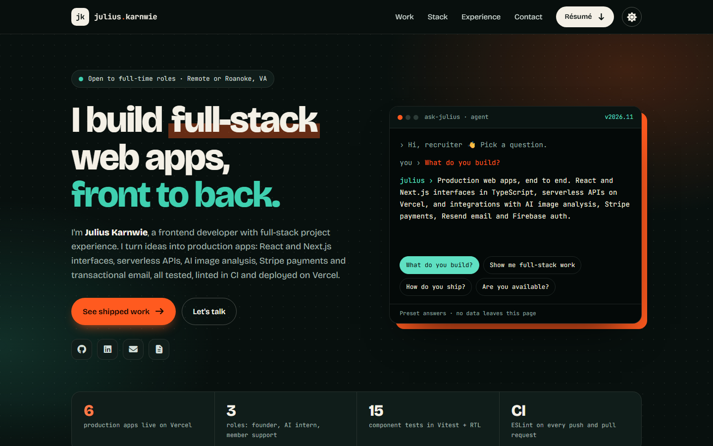
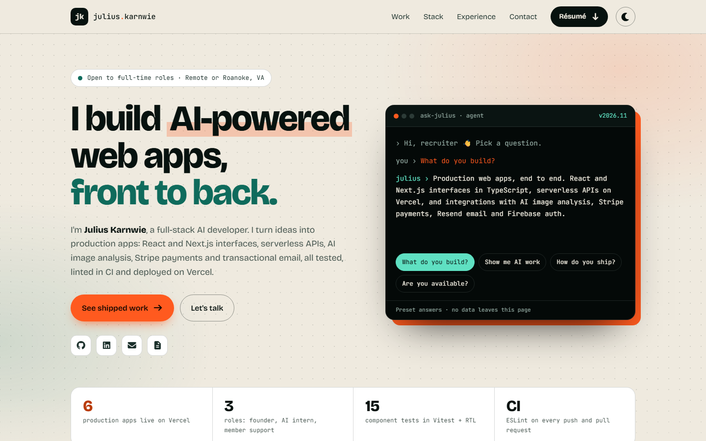
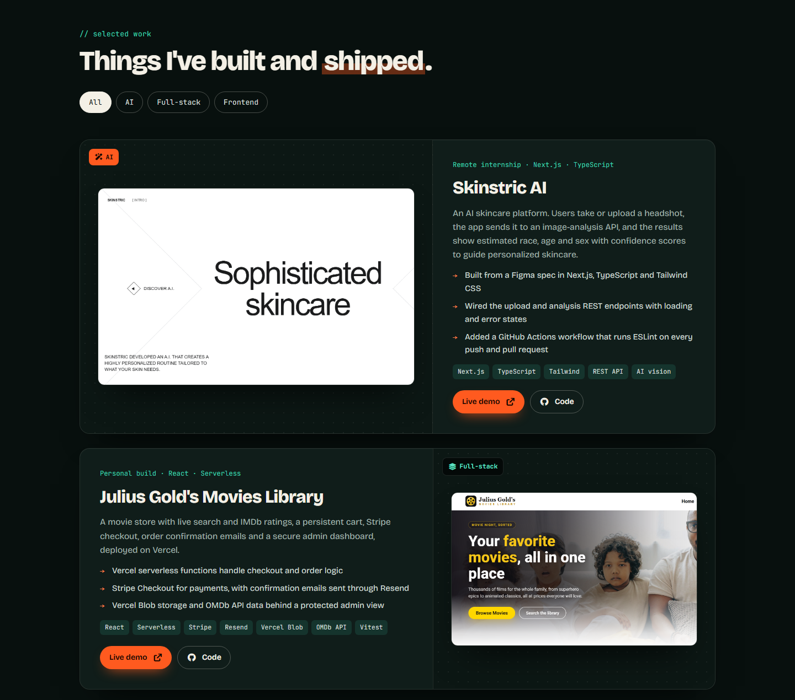
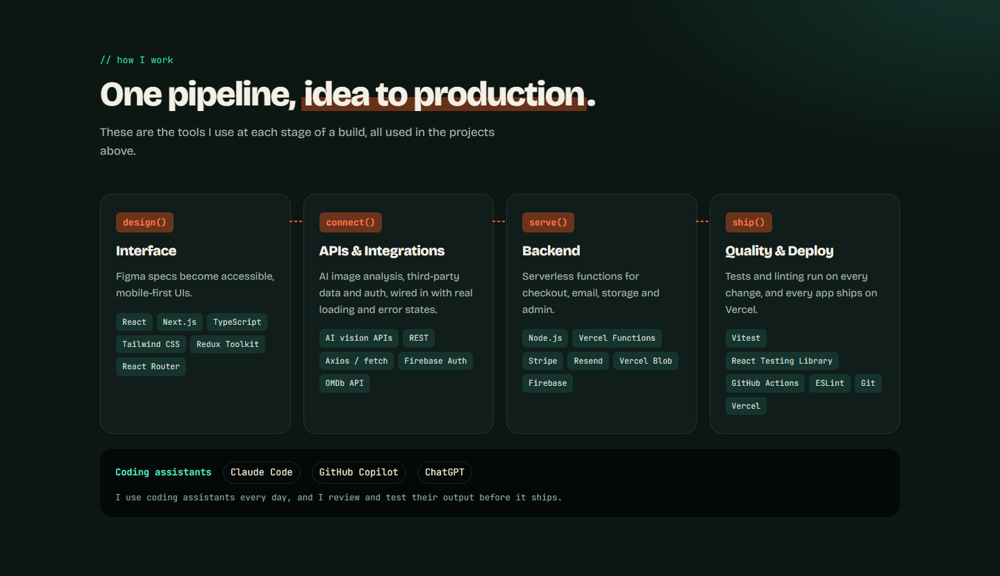
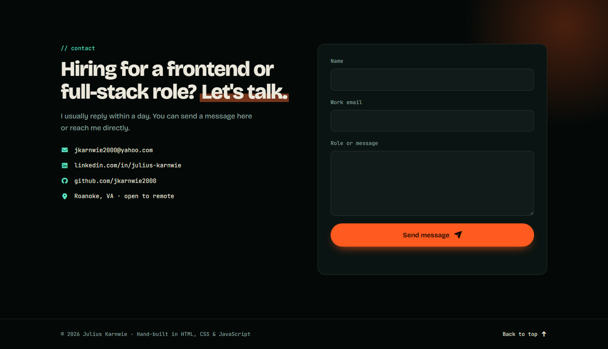
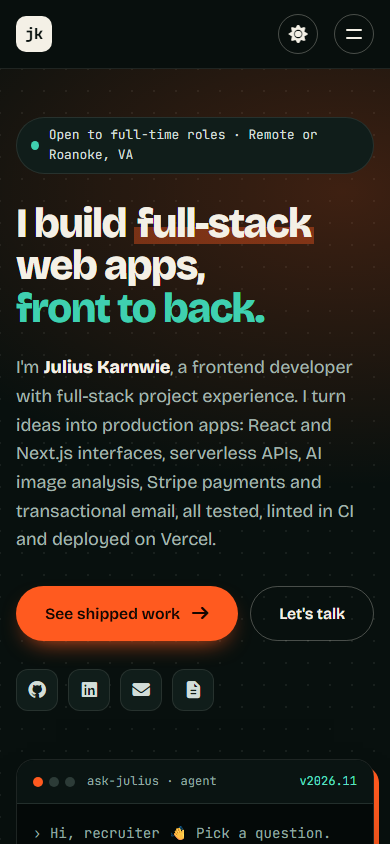

# Julius Karnwie | Full-Stack AI Developer Portfolio

**Live site:** [portfolio-website-verdigris.vercel.app](https://portfolio-website-verdigris.vercel.app)

## About

This is the personal portfolio of Julius Karnwie, a full-stack AI developer based in Roanoke, Virginia, and open to remote roles. It is built for technical recruiters and hiring managers who want to see shipped, working software quickly, so every project links to a live deployment and its source code.

The site is hand-built in semantic HTML, modern CSS and vanilla JavaScript, with no framework or build step. That keeps it fast, accessible and easy to audit. It uses a custom "Verdigris & Signal" design system: a deep pine background with bone-white text, signal-orange highlights and verdigris teal accents. Visitors can switch to a crisp light mode, and their choice is remembered.

The hero opens with an "Ask my portfolio" console. Recruiters tap a question, such as "Show me AI work" or "Are you available?", and a short answer types out in the style of an AI chat. The answers are preset, so no data leaves the page. A proof strip below it summarizes six production apps, three professional roles, fifteen component tests and continuous-integration linting on every push.

The Selected Work section presents six projects as featured case studies that can be filtered by AI, full-stack or frontend. They include Skinstric AI, an AI image-analysis skincare platform; Julius Gold's Movies Library and Summarist, both with Stripe checkout; Wakis Mart Deli & Grocery, built on Node.js, Express, PostgreSQL and Prisma; a Books e-commerce store with Stripe; and the Clear Member Credit Union dashboard, which explains banking in plain language.

A pipeline section maps the tools used at each stage of a build, from interface and AI integrations to serverless backends, testing and deployment. An experience timeline covers founding Karnwie's Golden Websites, a remote frontend internship at Skinstric AI and two years of credit union member support. The page ends with an inline contact form powered by EmailJS.

The layout is responsive from wide desktops down to 390-pixel phones, respects reduced-motion preferences and supports keyboard navigation. Project images load lazily so the page stays fast on mobile networks. The site deploys automatically to Vercel on every push to the main branch.

## Screenshots

**Hero: dark theme (default)**



**Hero: light theme**



**Selected work: filterable project case studies**



**How I work: the build pipeline**



**Contact: inline EmailJS form**



**Mobile (390 px)**



## Tech Stack

- **HTML5:** semantic, accessible markup
- **CSS3:** custom properties for theming, CSS Grid and Flexbox, responsive breakpoints
- **JavaScript (ES6+):** theme toggle, project filters, console, scroll reveals, contact form
- **EmailJS:** contact form delivery
- **Font Awesome and Google Fonts:** icons, Bricolage Grotesque and JetBrains Mono
- **Vercel:** hosting, with automatic deploys from GitHub

## Project Structure

```text
PortfolioWebsite/
├── assets/            # project screenshots, résumé PDF and images
├── docs/screenshots/  # README screenshots (not deployed)
├── index.html         # page markup and content
├── style.css          # "Verdigris & Signal" theme and layout
├── index.js           # interactivity and the EmailJS contact form
├── .vercelignore      # files kept out of the deployment
└── README.md
```

## Run Locally

The site is static, so there is nothing to install or build.

1. Clone the repository:

   ```bash
   git clone https://github.com/jkarnwie2000/PortfolioWebsite.git
   cd PortfolioWebsite
   ```

2. Open `index.html` with a local server, such as the Live Server extension in Visual Studio Code, or run:

   ```bash
   npx serve .
   ```

## Deployment

The repository is connected to Vercel. Every push to `main` deploys to production automatically, and other branches get preview links.

## Contact

- Portfolio: [portfolio-website-verdigris.vercel.app](https://portfolio-website-verdigris.vercel.app)
- LinkedIn: [linkedin.com/in/julius-karnwie-173b4a7](https://www.linkedin.com/in/julius-karnwie-173b4a7/)
- Email: jkarnwie2000@yahoo.com
